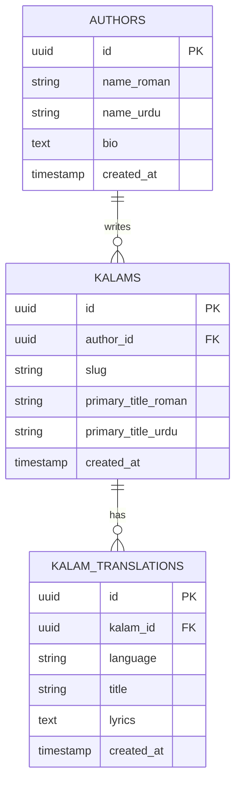
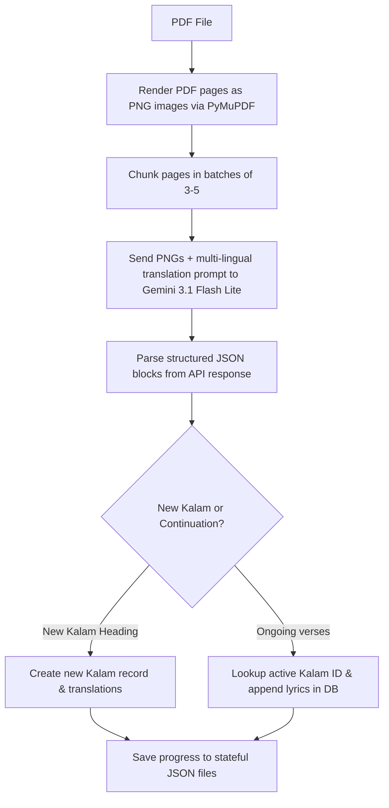

# Kalam Library

Kalam Library is a modern, high-performance, and visually stunning multi-lingual Naat lyrics repository. It enables users to read, share, and discover classic Sufi poetry in Roman English, Urdu, Hindi, and Bangla. The system utilizes Next.js 16 (App Router), Tailwind CSS v4, Supabase (PostgreSQL), and an automated stateful AI-powered ingestion pipeline using the Gemini API.

---

## 🏗️ Database Architecture

The repository's relational database is built on Supabase (Postgres) and consists of three main tables linked by standard relational constraints:



### Table Details:
1. **`authors`**: Stores poet profiles (e.g., Imam Ahmad Raza Khan Qadri, Muhammad Ilyas Attar Qadri) with Roman names, Urdu Nastaliq names, and bios.
2. **`kalams`**: Stores the primary Kalam shell metadata with a unique slug and primary titles.
3. **`kalam_translations`**: Stores the actual transcribed lyrics and titles partitioned by language (`urdu`, `roman_english`, `hindi`, `bangla`) for each Kalam. High-performance lookups are guaranteed via composite uniqueness on `(kalam_id, language)` and targeted indexes.

---

## ⚙️ Ingestion & Synchronization Pipeline (AI OCR Parser)

Because historical collections are printed as scanned PDFs, the project features a robust, stateful automated Python ingestion engine:



### Key Ingestion Ingestion Patterns:
- **Stateful Crawler Tracker**: Saves processed ranges in `{pdf_name}_progress_stateful.json` and active context (like current ongoing Kalam ID) in `{pdf_name}_state.json`. If the pipeline halts, it auto-resumes without duplicating records.
- **Batched Multimodal AI Analysis**: Renders PDF pages to high-resolution PNGs and leverages the multimodal `gemini-3.1-flash-lite` model for high-accuracy line-by-line transcription and matching transliterations.
- **Aggressive Quota & Failure Resilience**: Automatically catches API issues (such as `RESOURCE_EXHAUSTED` 429 errors), applies exponential backoff, and cools down for 15 seconds between requests to maintain robust throughput.

---

## 🎨 Visual Design Aesthetics

The application implements a premium, dark-mode focused visual environment:
- **Curated Palette**: A rich base of Deep Emerald (`#020806`, `hsl(160, 50%, 4%)`) mixed with harmonious Warm Gold (`hsl(45, 85%, 60%)`) highlight typography.
- **Glassmorphic Elements**: Card backgrounds make use of subtle backdrops (`backdrop-blur-md`) and thin borders (`border-emerald-500/10`) to look modern and deep.
- **Micro-Animations**: Hover states feature smooth transitions (`transition-all`) and soft glowing gold shadows (`.hover-gold-glow`).
- **Typography**: Integrates Google Fonts (`Outfit` for crisp headlines, `Inter` for regular text, and `Noto Nastaliq Urdu` / `Jameel Noori Nastaleeq` for authentic RTL Urdu presentation).

---

## 🔍 SEO & Structural Best Practices

Automatic indexing and discoverability are designed directly into the page layouts:
- **Dynamic Meta Generation**: Generates contextual tags (`title`, `description`) for all languages and paths.
- **Canonical Alternate Links**: Automatically includes multi-language canonical headers (`alternates.languages`) pointing to corresponding translations.
- **Structured Schema Markup**: Embeds complete `MusicComposition`, `Lyrics`, and `Person` JSON-LD schema blocks on every page to ensure clean Google search snippets.

---

## 🛠️ Tech Stack

- **Framework**: [Next.js 16 (App Router)](https://nextjs.org/)
- **State Management & Database**: [Supabase JS SDK Client](https://supabase.com/) & PostgreSQL
- **Styling**: [Tailwind CSS v4](https://tailwindcss.com/)
- **Languages**: React 19, TypeScript, Python 3
- **Ingestion Tools**: PyMuPDF (`fitz`), Pillow (`PIL`), `google-genai` SDK

---

## 🚀 Setup & Execution

### 1. Configure Environment
Create a `.env.local` file in the root directory:
```env
NEXT_PUBLIC_SUPABASE_URL=https://your-project.supabase.co
NEXT_PUBLIC_SUPABASE_PUBLISHABLE_KEY=your-anon-key
SUPABASE_SERVICE_ROLE_KEY=your-service-role-key
GEMINI_API_KEY=your-gemini-api-key
```

### 2. Database Schema Setup
Run the SQL queries in `utils/schema.sql` directly inside the Supabase SQL editor.

### 3. Run Web App
```bash
npm install
npm run dev
```

### 4. Run PDF Extraction Ingestion
To extract and synchronize a PDF book:
```bash
pip install google-genai pymupdf pillow supabase pypdf
python scripts/extract_naats.py --pdf public/wasail-e-bakhshish.pdf --start 90 --end 733 --author "Muhammad Ilyas Attar Qadri" --chunk 5 --non-interactive
```
